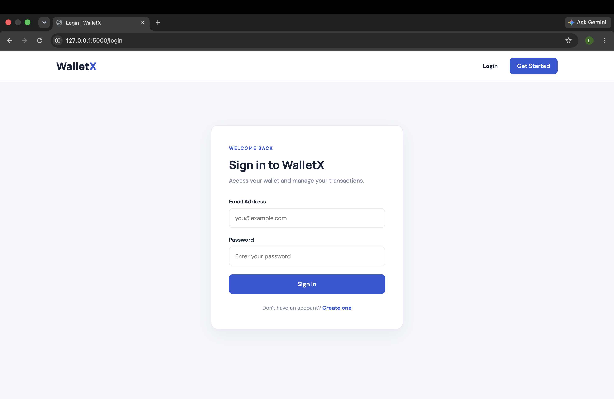
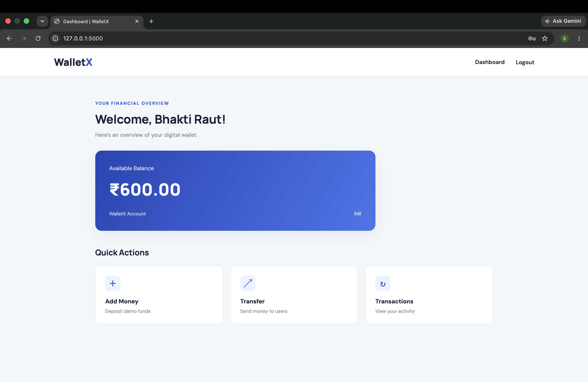
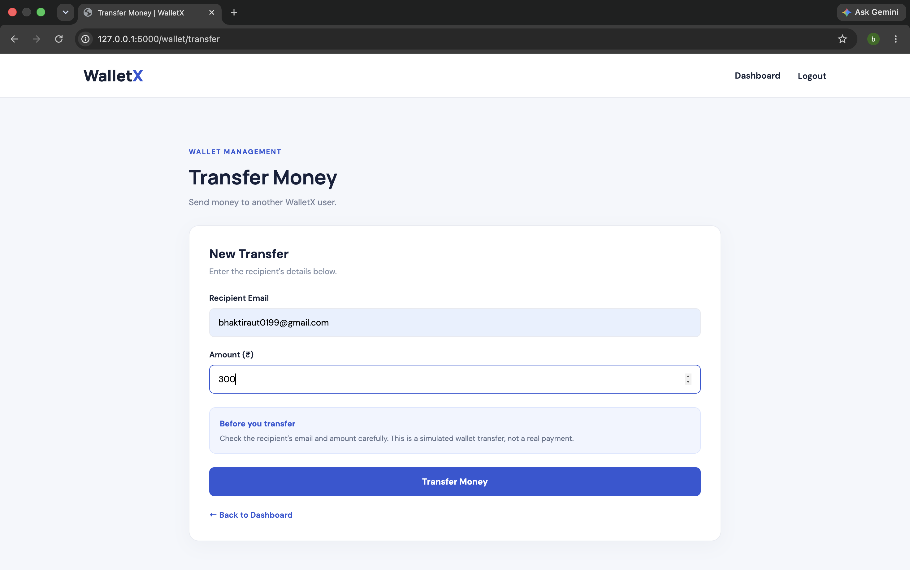
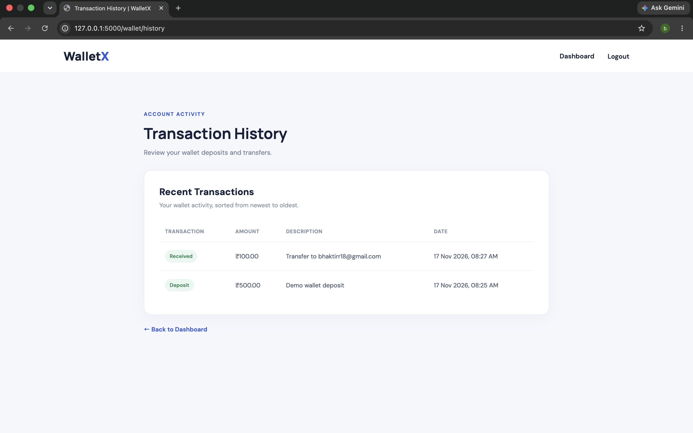

# WalletX – Digital Wallet & Payment Management System

A web-based digital wallet application built using Python, Flask, and SQLite. WalletX allows users to create accounts, manage demo wallet balances, transfer funds between registered users, and view transaction history.

> **Note:** This is an academic portfolio project. Deposits and transfers are simulated. No real money, bank accounts, or payment gateways are involved.

## Features

- **User Authentication:** User registration, login, logout, and secure password hashing.
- **Individual Wallets:** Automatic wallet creation for every registered user.
- **Demo Deposits:** Add simulated funds to a wallet.
- **Wallet Transfers:** Transfer demo funds between registered users.
- **Transaction History:** View deposits, sent transfers, and received transfers.
- **Balance Validation:** Prevent transfers exceeding the available balance.
- **Input Validation:** Validate email addresses, passwords, and transaction amounts.
- **Duplicate Transaction Protection:** Use idempotency keys to prevent duplicate transaction processing.
- **Database Transactions:** Commit or roll back related balance updates and transaction records together.
- **CSRF Protection:** Protect form submissions using Flask-WTF.

## Technology Stack

| Category | Technologies |
|---|---|
| Backend | Python, Flask |
| Database | SQLite |
| ORM | Flask-SQLAlchemy, SQLAlchemy |
| Authentication | Flask-Login, Werkzeug |
| Security | Flask-WTF, CSRF Protection |
| Frontend | HTML5, CSS3, JavaScript |
| Testing | Pytest, pytest-cov |
| Development Tools | VS Code, Git, GitHub |

## Project Structure

```text
digital-wallet-management-system/
│
├── app/
│   ├── models/          # User, Wallet and Transaction models
│   ├── routes/          # Authentication, dashboard and wallet routes
│   ├── services/        # Authentication and transaction business logic
│   ├── utils/           # Money conversion, validation and exceptions
│   ├── templates/       # HTML templates
│   └── static/          # CSS and JavaScript
│
├── tests/               # Automated test suite
├── instance/            # Local SQLite database (not committed)
├── config.py            # Application configuration
├── run.py               # Application entry point
├── requirements.txt     # Python dependencies
├── pytest.ini           # Pytest configuration
├── .env.example         # Environment variable template
├── .gitignore
└── README.md
```
## Application Screenshots

### 1. Login Page


### 2. Dashboard


### 3. Money Transfer


### 4. Transaction History



## Installation and Setup

### 1. Clone the repository

```bash
git clone https://github.com/bhaktirr18/digital-wallet-management-system.git
cd digital-wallet-management-system
```

### 2. Create a virtual environment

```bash
python3 -m venv venv
```

Activate it:

**macOS / Linux**
```bash
source venv/bin/activate
```

**Windows**
```bash
venv\Scripts\activate
```

### 3. Install dependencies

```bash
python -m pip install --upgrade pip
pip install -r requirements.txt
```

### 4. Configure environment variables

Create a `.env` file in the project root using `.env.example` as a reference.

```env
SECRET_KEY=your-random-secret-key
DATABASE_URL=sqlite:///wallet.db
FLASK_DEBUG=True
```

Generate a secure secret key using:

```bash
python -c "import secrets; print(secrets.token_hex(32))"
```

Replace the placeholder with the generated key.

**Important:** Never commit your actual `.env` file.

### 5. Run the application

```bash
python run.py
```

Open the following URL in your browser:

```text
http://127.0.0.1:5000
```

Register an account to start using WalletX.

## Running Tests

Run the automated test suite:

```bash
python -m pytest
```

Run tests with coverage:

```bash
python -m pytest --cov=app
```

The project includes tests for:

- Money conversion and validation
- User authentication
- Wallet operations
- Transfers and balance validation
- Duplicate transaction protection
- Application routes

**Latest local test result:** 32 tests passed.

## Financial Data Handling

Wallet balances and transaction amounts are stored as integer paise rather than floating-point values to avoid precision errors in monetary calculations.

For example:

- ₹100.00 = 10,000 paise
- ₹250.50 = 25,050 paise

Python's `Decimal` is used when converting user-entered rupee amounts into paise.

## Important Limitations

- This project uses simulated funds and does not process real payments.
- SQLite is used for local development and demonstration.
- SQLite has concurrency limitations and is not intended here as a production financial database.
- A production deployment would require additional security, monitoring, operational controls, and a more suitable database such as PostgreSQL.

## Future Enhancements

- Password reset functionality
- User profile management
- Pagination and filtering for transaction history
- PostgreSQL integration
- Improved transaction monitoring and audit logging
- Deployment to a cloud hosting platform

## Author

**Bhakti Raut**

Computer Engineering Student
Trinity Academy of Engineering, Pune

[GitHub](https://github.com/bhaktirr18)